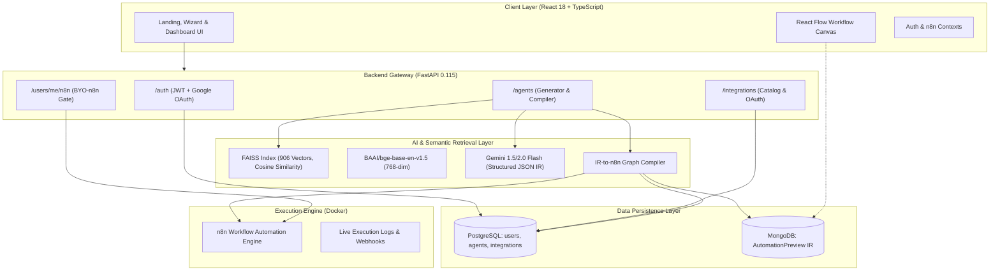

# OmniAgent — Final-Year Academic Project Documentation Handover

This handover document provides verified, documentation-ready summaries tailored specifically for **Chapters 3, 4, 5, and the Appendices** of the B.Tech Computer Engineering Final-Year Project Report:

**Title:** OmniAgent – A Multi-Industry AI Agent Generator Platform

---

## 1. Content for Chapter 3: Project Design & Architecture

### 3.1 Architectural Overview
OmniAgent is designed as a hybrid microservice and multi-tiered agent generation platform. It decouples the natural language agent specification layer from actual low-code execution using a 4-tier model:

1. **Client Tier (Presentation):** React 18 SPA built with Vite, TypeScript, Tailwind CSS, shadcn/ui, and React Flow (`@xyflow/react`) for interactive workflow graph rendering.
2. **API & Service Tier (Orchestration):** FastAPI (Python 3.11) exposing 28 RESTful endpoints. Manages semantic search, LLM prompt engineering, intermediate representation (IR) compilation, credential management, and user authentication.
3. **Data Persistence Tier (Hybrid Data Model):**
   - **PostgreSQL:** Stores user accounts, bcrypt password hashes, agent bridge records, and third-party credential metadata.
   - **MongoDB:** Stores schema-versioned, provider-agnostic workflow preview IR documents (`AutomationPreview` collection).
   - **FAISS Vector Index:** In-memory `IndexFlatIP` cosine similarity index containing 906 pre-indexed automation templates embedded via `BAAI/bge-base-en-v1.5` (768 dimensions).
4. **Execution & Runtime Tier (BYO-n8n Engine):** A decoupled, containerized n8n workflow engine connected via REST APIs. All sensitive API keys and execution logs remain on the user's private instance, ensuring security and zero lock-in.

### 3.2 High-Level System Architecture Diagram (Mermaid)



---

## 2. Content for Chapter 4: Implementation Details

### 4.1 Hybrid Retrieval-Augmented Workflow Synthesis (RAG + Cache)
When a user submits a natural-language intent (e.g., *"Summarize incoming customer emails from Gmail, extract action items with AI, and post them to Slack"*):

1. **Embedding Generation:** The query is encoded into a 768-dimensional normalized dense vector using Hugging Face's `BAAI/bge-base-en-v1.5`.
2. **FAISS Similarity Search:** Cosine similarity is computed against 906 seed automation templates across Corporate, Education, and Finance domains.
3. **Threshold Decision ($\tau = 0.75$):**
   - **Score $\ge 0.75$:** A high-confidence match is detected. The cached intermediate representation (IR) is fetched from MongoDB. If its `schema_version` matches the current compiler version, it is served immediately without LLM invocation (sub-100ms response).
   - **Score $< 0.75$:** Novel intent. A structured prompt injected with similar domain examples and whitelisted catalog services is dispatched to `gemini-3.1-flash-lite`. The generated IR is validated, saved to MongoDB, and added to the FAISS index.

### 4.2 Intermediate Representation (IR) Schema
The synthesis engine generates an intermediate JSON format decoupling the prompt from n8n-specific node definitions:

```json
{
  "schema_version": 2,
  "automation_name": "Customer Email Summary to Slack",
  "automation_description": "Summarizes Gmail inbox messages using AI and sends a Slack alert",
  "required_integrations": [
    {"service": "gmail", "display_name": "Gmail", "required": true},
    {"service": "groq", "display_name": "Groq", "required": true},
    {"service": "slack", "display_name": "Slack", "required": true}
  ],
  "preview_json": {
    "trigger": {
      "service": "gmail",
      "event": "email_received",
      "display_name": "When an email is received"
    },
    "steps": [
      {
        "step": 1,
        "service": "groq",
        "action": "ai_agent",
        "instructions": "Summarize email body and list action items"
      },
      {
        "step": 2,
        "service": "slack",
        "action": "send_message",
        "depends_on": [1]
      }
    ]
  }
}
```

### 4.3 Multi-Stage Graph Compilation & n8n Deployment
The compiler (`server/app/compiler/`):
1. **Dynamic Parameter Form Generation (`param_schema.py`):** Inspects each step and extracts required parameters (e.g., Slack Channel ID, Gmail Query filters). It surfaces data bindings allowing fields to dynamically reference upstream trigger outputs (`={{ $json.subject }}`).
2. **AI Provider Node Replacement (`ai_selection.py`):** Replaces the placeholder AI node with the user's selected Chat Model (Groq, OpenAI, Anthropic, Gemini, Mistral, OpenRouter).
3. **Graph Topological Layout (`layout.py`):** Applies Dagre-based horizontal coordinates (`[X, Y]`) to nodes.
4. **n8n REST Deployment (`create-workflow`):** Compiles node connections (`main` and `ai_languageModel` wires), calls `POST /api/v1/workflows` on the user's n8n instance, commits an `Agent` record to PostgreSQL with the user's `n8n_connection_id` stamp, and calls `POST /api/v1/workflows/{id}/activate`.

---

## 3. Content for Chapter 5: Conclusion & Further Work

### 5.1 Project Achievements
- Fully implemented natural language-to-workflow generation pipeline with dynamic parameter form generation.
- Established Bring-Your-Own-n8n (BYO-n8n) architecture eliminating centralized credential risk.
- Developed hybrid caching with FAISS and MongoDB, reducing LLM API consumption for common automation templates.
- Built a multi-provider AI abstraction supporting 6 commercial and open-source model providers.
- Validated with 239 passing backend unit tests and 39 passing frontend unit tests.

### 5.2 Recommended Further Work
1. **In-Place Workflow Editing:** Implement `PUT /agents/{id}` allowing deployed n8n workflows to be updated directly from the UI without requiring re-creation.
2. **WebSocket Live Execution Streaming:** Replace the current execution polling model (`GET /agents/{id}/runs`) with WebSocket streaming to monitor running agent pipelines in real-time.
3. **Dynamic Document Upload & RAG Stores:** Complete the dormant `pypdf` and `bs4` integration to allow users to upload proprietary enterprise documents (PDFs, manuals) directly into an agent's vector store.
4. **Automated Error Recovery & Self-Healing:** Implement webhook feedback loops that catch failed n8n executions, analyze error stack traces with an LLM, and automatically suggest parameter fixes.
