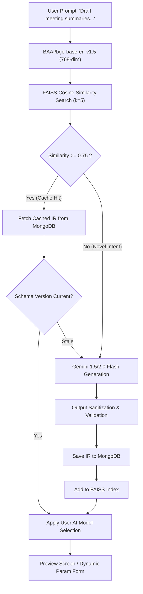

# OmniAgent — Final Comprehensive Technical Implementation Audit

**Academic Project:** Final-Year B.Tech Computer Engineering Capstone  
**Project Title:** OmniAgent – A Multi-Industry AI Agent Generator Platform  
**Audit Conducted:** November 18, 2026  
**Auditor Role:** Senior Software QA Engineer, AI Agent Architect, and Full-Stack Application Auditor  
**Audit Policy:** Read-Only Verification (Strictly non-destructive; 0 application source files modified)

---

## 1. Executive Summary

This document presents the definitive technical implementation audit of the **OmniAgent** platform. OmniAgent is an AI-driven multi-industry automation generator designed to bridge natural-language user intentions with production-grade workflow automation engines.

### Key Audit Findings:
- **Total Application Endpoints:** **28** registered HTTP endpoints across **6** backend routers (plus 4 built-in FastAPI OpenAPI documentation routes, totaling 32 runtime routes).
- **Frontend Architecture:** **10** client-side routes built with React 18, Vite 5, TypeScript 5.8, Tailwind CSS, shadcn/ui, Radix UI primitives, and React Flow (`@xyflow/react`).
- **Database Architecture:** Hybrid multi-model persistence:
  - **PostgreSQL:** Relational store with 3 primary entities (`users`, `agents`, `integrations`), secured with Alembic migrations and Fernet encryption.
  - **MongoDB:** Document store containing the `AutomationPreview` collection for schema-versioned workflow intermediate representations (IR).
  - **FAISS Vector Index:** In-memory dense vector index (`IndexFlatIP`) holding **906** pre-indexed domain templates embedded via `BAAI/bge-base-en-v1.5` (768 dimensions).
- **Core AI Pipeline:** Implements a hybrid semantic retrieval-augmented synthesis engine:
  - Similarity score $\ge 0.75$ serves cached preview IRs from MongoDB.
  - Novel intents invoke Google Gemini (`gemini-3.1-flash-lite`) via `langchain-google-genai` with structured JSON output enforcement.
- **Workflow Compilation & Deployment:** The proprietary compiler translates high-level IR graphs into executable n8n workflow JSON, generates dynamic parameter form schemas with upstream data expressions, and deploys directly to the user's personal n8n instance via REST API.
- **Verification Status:** **239** backend unit tests passed (compiler, AI providers, password hashing); **39** frontend unit tests passed; **3,529** modules compiled cleanly in production build.

---

## 2. Repository Structure

```
OmniAgent/
├── client/                     # Frontend Single Page Application (React 18 + Vite)
│   ├── src/
│   │   ├── components/         # Reusable UI & Domain Components
│   │   │   ├── auth/           # AuthCard, AuthInputField, AuthPageShell, GoogleIcon
│   │   │   ├── dashboard/      # AgentCard, DashboardSidebar, IntegrationCard, StatCard
│   │   │   ├── landing/        # HeroSection, Navbar, ThemeToggle, HowItWorksSection
│   │   │   ├── n8n/            # ConnectN8nModal, N8nConnectionPanel, CopyableUrl
│   │   │   ├── ui/             # 40+ shadcn/ui accessible components
│   │   │   └── workflow/       # WorkflowCanvas, AIProviderPicker, ConfigureWorkflowStep
│   │   ├── context/            # AuthContext, N8nContext, ThemeContext
│   │   ├── layouts/            # DashboardLayout (Sidebar, TopNav, Outlet)
│   │   ├── lib/                # agentsApi.ts, buildWorkflowGraph.ts, edit-agent-data.ts
│   │   ├── pages/              # 10 core pages (Index, NewAgentCreation, MyAgents, etc.)
│   │   └── types/              # Type definitions
│   ├── package.json            # 53 runtime dependencies, 18 dev dependencies
│   └── vite.config.ts          # Vite build configuration
├── server/                     # Backend API & Compiler Service (FastAPI + Python 3.11)
│   ├── app/
│   │   ├── compiler/           # IR to n8n compiler (compile, layout, param_form, bindings)
│   │   ├── core/               # ai_providers, auth, config, n8n_gate, integration_catalog
│   │   ├── models/             # SQLAlchemy (User, Agent, Integration) & MongoDB models
│   │   ├── routers/            # 6 routers (auth, agent_router, agent_lifecycle, etc.)
│   │   ├── schemas/            # Pydantic schemas (ai_provider, user, n8n, integration)
│   │   ├── services/           # llm_service, vectorstore, n8n_client, workflow_generator
│   │   ├── utils/              # crypto.py (Fernet symmetric encryption)
│   │   ├── database.py         # PostgreSQL engine & AsyncMongoClient initialization
│   │   └── main.py             # FastAPI entrypoint, middleware, and router registration
│   ├── alembic/                # Database migrations
│   ├── faiss_index/            # index.faiss (906 vectors) and index.pkl metadata
│   ├── scripts/                # Utility scripts (build_faiss.py, calibrate_threshold.py)
│   ├── tests/                  # 17 test modules (compiler tests, unit tests, fixtures)
│   └── requirements.txt        # Backend dependencies
├── infrastructure/             # Docker deployment files
│   └── docker-compose.yml      # Containerized n8n execution engine
└── docs/                       # Project documentation & audit deliverables
    ├── api_audit/              # Read-only API route audit files
    └── final_audit/            # Comprehensive implementation audit deliverables
```

---

## 3. Technology Stack and Verified Versions

1. **Frontend:** React `18.3.1`, TypeScript `5.8.3`, Vite `5.4.19`, Tailwind CSS `3.4.17`, Framer Motion `11.0.0`, React Router DOM `6.30.1`, React Flow (`@xyflow/react`) `12.10.2`, Dagre `0.8.5`, Sonner `1.7.4`.
2. **Backend:** Python `3.11.4`, FastAPI `0.115.0`, Uvicorn `0.30.6`, SQLAlchemy `2.0.35`, Psycopg 3 `3.3.8`, Alembic `1.13.2`, PyMongo `4.19.0`, HTTPX `0.27.0`.
3. **AI & Semantic Search:** FAISS `1.15.1` (`faiss-cpu`), `BAAI/bge-base-en-v1.5` (768-dim embeddings via `sentence-transformers` `6.2.0` and `langchain-huggingface` `1.2.3`), `langchain-google-genai` `4.4.3` (`gemini-3.1-flash-lite`).
4. **Security & Cryptography:** Bcrypt `4.0.1` (salted password hashing), PyJWT `2.15.1` (HS256 tokens), Cryptography `50.0.2` (Fernet symmetric key encryption), Authlib `1.3.1` (Google OAuth 2.0 OpenID Connect).
5. **Workflow Automation:** n8n `n8nio/n8n:latest` via Docker.

---

## 4. Frontend Feature Implementation Audit

The frontend implements 10 declarative routes managed via React Router in `client/src/App.tsx`:

### 4.1 Implemented Pages & Workflows

1. **Landing Page (`/` — `Index.tsx`):**
   - Implements dynamic dark/light theme switching via `ThemeToggle.tsx`.
   - Displays animated interactive network canvas (`CinematicAiNetworkCanvas.tsx`).
   - Showcases value propositions, before-vs-after comparisons, and how-it-works interactive walkthroughs.
2. **Authentication Pages (`/sign-in`, `/sign-up`, `/oauth/callback`):**
   - Local authentication forms with floating labels, instant client-side validation, and show/hide password visibility toggles (`AuthInputField.tsx`).
   - Integrated Google OAuth 2.0 button initiating OpenID Connect flow.
   - Token reception and storage via `OAuthCallback.tsx`, persisting JWT in `localStorage` through `AuthContext.tsx`.
3. **Agent Creation Wizard (`/new-agent` — `NewAgentCreation.tsx`):**
   - **Step 1 (Intent & Domain):** Multi-industry selector (Corporate, Education, Finance) with sample prompt cards.
   - **Step 2 (Review & Model Selection):** Displays React Flow visual graph, integration readiness badges, prompt editing loop (`edit_of`), and model selector (`AIProviderPicker.tsx`).
   - **Step 3 (Ambiguity Resolution):** Automatically displays `OperationPicker.tsx` if generated workflow steps contain ambiguous candidate operations.
   - **Step 4 (Parameter Form Configuration):** Dynamic input forms (`ConfigureWorkflowStep.tsx`, `ParamFieldInput.tsx`) displaying required fields, options, and upstream node data bindings.
   - **Step 5 (Deployment & Result):** Deploys to personal n8n instance, guards against duplicate names, provides instant activation retry, and presents `CreateResult.tsx`.
4. **My Agents (`/agents` — `MyAgents.tsx`):**
   - Lists all user agents from PostgreSQL.
   - Displays agent status badge (`active`, `inactive`, `created`, `failed`, `stale`).
   - Provides one-click action buttons: Activate, Deactivate, View Runs, Delete.
   - Supports live status synchronization with n8n (`?refresh=true`).
5. **Integrations Manager (`/integrations` — `Integrations.tsx`):**
   - Searchable and filterable grid displaying 426 third-party services.
   - Text-field connection modal for API keys / tokens (Pattern 1).
   - OAuth2 popup consent flow for third-party services (Pattern 2/4).
   - Stale credential detection with one-click cleanup.
6. **Settings Page (`/settings` — `Settings.tsx`):**
   - **n8n Tab:** Implements `N8nConnectionPanel.tsx` enabling users to connect their personal n8n instance (URL, API key, email, password) with live connectivity validation.
   - **User & AI Tabs:** Displays profile information and visual AI adjustment sliders.

---

## 5. Backend Architecture & Complete API Route Summary

The backend exposes **28** endpoints across 6 routers + root app:

### Endpoint Distribution
- **GET (12 endpoints):** `/`, `/search`, `/auth/google/login`, `/auth/google/callback`, `/users/me/n8n`, `/ai-providers`, `/ai-providers/default`, `/integrations`, `/integrations/oauth/status/{service}`, `/agents/preview/{name}/param-schema`, `/agents`, `/agents/{id}/runs`.
- **POST (11 endpoints):** `/auth/signin`, `/auth/signup`, `/integrations/connect/text-fields`, `/integrations/check`, `/integrations/oauth/connect`, `/agents/extract-workflow`, `/agents/preview/{name}/ai-selection`, `/agents/preview/{name}/param-schema`, `/agents/preview/{name}/create-workflow`, `/agents/{id}/activate`, `/agents/{id}/deactivate`.
- **PUT (2 endpoints):** `/users/me/n8n`, `/ai-providers/default`.
- **DELETE (3 endpoints):** `/users/me/n8n`, `/integrations/{service}`, `/agents/{id}`.

### Security Distribution
- **Public:** 6 endpoints.
- **JWT Protected (`Depends(get_current_user)`):** 15 endpoints.
- **JWT + n8n Gate (`Depends(require_n8n)`):** 7 endpoints.

---

## 6. Authentication and Security Audit

1. **User Registration (`server/app/routers/auth.py#L145`):**
   - Validates password length ($\ge 8$ characters) and UTF-8 byte length ($\le 72$ bytes to avoid Bcrypt silent truncation).
   - Verifies email uniqueness in PostgreSQL.
   - Hashes passwords using `bcrypt.hashpw(data, bcrypt.gensalt())`.
2. **Local Login (`server/app/routers/auth.py#L117`):**
   - Authenticates credentials against stored Bcrypt hash.
   - Mitigates timing attacks using dummy hash comparison on non-existent accounts.
   - Issues HS256 JWT access tokens containing user email, full name, and 30-minute expiry (`exp`).
3. **Google OAuth 2.0 (`server/app/routers/auth.py#L50-L115`):**
   - Implements OpenID Connect authorization code flow via Authlib Starlette client.
   - Enforces verified email check (`userinfo.get("email_verified") is True`).
   - Automatically links Google sub to existing local accounts or creates new users.
4. **Credential Protection at Rest:**
   - User n8n API keys and session passwords are encrypted at rest in PostgreSQL columns `n8n_api_key_enc` and `n8n_password_enc` using Fernet symmetric encryption (`server/app/utils/crypto.py`).
   - Secrets are decrypted only in memory when constructing the transient `N8nClient`.
5. **SSRF Mitigation (`server/app/core/n8n_url.py`):**
   - User-supplied n8n base URLs are parsed to block userinfo, paths, queries, and fragments.
   - Resolves hostnames via `getaddrinfo` and rejects non-global, loopback, private (RFC 1918), and link-local IP addresses (e.g., `169.254.169.254`).

---

## 7. AI Agent Generation Pipeline



### Pipeline Parameters:
- **Embedding Model:** `BAAI/bge-base-en-v1.5` with normalized embeddings.
- **Similarity Metric:** Cosine similarity ($1 - \text{distance}/2$).
- **Calibrated Threshold:** $\tau = 0.75$.
- **Retrieval Results ($top\_k$):** 5 templates.
- **Workflow Synthesis LLM:** `gemini-3.1-flash-lite` via `ChatGoogleGenerativeAI`.

---

## 8. Compiler and n8n Deployment Engine

The compiler (`server/app/compiler/`) transforms high-level IR graphs into executable n8n workflows:

1. **Step Ingestion (`loader.py`):** Converts preview JSON steps and triggers into unlinked compiler step definitions.
2. **Dynamic Form Construction (`param_form.py`):**
   - Matches step services against `generated_registry.json`.
   - Extracts required node properties, default values, and data types (string, number, boolean, options).
   - Generates upstream data bindings (e.g. `={{ $json.body }}`) allowing users to wire trigger data directly into action nodes.
3. **Graph Topology & Auto-Layout (`layout.py`):** Positions n8n nodes horizontally on a 2D canvas with computed `[X, Y]` coordinates to prevent visual overlap.
4. **Credential Mapping (`credential_resolver.py`):** Maps required services to the user's active n8n credential IDs stored in PostgreSQL.
5. **n8n REST Deployment:**
   - Calls `POST /api/v1/workflows` to create the workflow graph in n8n.
   - Inserts `Agent` record in PostgreSQL stamped with `n8n_connection_id`.
   - Calls `POST /api/v1/workflows/{id}/activate`.

---

## 9. Database Architecture & Persistence Models

### 9.1 PostgreSQL Tables

1. **`users` Table:**
   - Columns: `id` (UUID PK), `email` (unique index), `password` (bcrypt hash), `provider` (local/google), `provider_id`, `full_name`, `is_active`, `is_verified`, `created_at`, `updated_at`.
   - Personal n8n Fields: `n8n_base_url`, `n8n_api_key_enc`, `n8n_email`, `n8n_password_enc`, `n8n_connection_id` (UUID), `n8n_connected_at`.
   - User Defaults: `default_ai_provider`, `default_ai_model`.
2. **`agents` Table:**
   - Columns: `id` (UUID PK), `user_id` (FK to `users.id`), `automation_name`, `workflow_name`, `n8n_workflow_id` (unique), `n8n_connection_id` (UUID instance stamp), `status` (created/active/inactive/failed/missing), `last_error`, `ai_provider`, `ai_model`, `created_at`, `updated_at`.
   - Constraints: `UniqueConstraint("user_id", "workflow_name")`.
3. **`integrations` Table:**
   - Columns: `id` (UUID PK), `user_id` (FK to `users.id`), `service`, `display_name`, `n8n_credential_id`, `n8n_credential_type`, `n8n_connection_id` (UUID instance stamp), `auth_option_id`, `connection_pattern`, `oauth_pending`, `is_active`, `created_at`, `updated_at`.
   - Constraints: `UniqueConstraint("user_id", "service")`.

### 9.2 MongoDB Collections

- **`AutomationPreview` Collection:**
  - Document Structure: `_id` (ObjectId), `schema_version` (int), `automation_name` (unique index), `automation_description` (str), `required_integrations` (list), `preview_json` (trigger and steps IR dict), `created_at` (datetime UTC).
  - Unowned, shared document store serving as generation cache.

### 9.3 FAISS Vector Index

- **Files:** `server/faiss_index/index.faiss`, `server/faiss_index/index.pkl`.
- **Dimensions:** 768.
- **Vectors in Index:** 906.
- **Distance Metric:** Inner Product / Cosine Similarity.

---

## 10. Implementation Gaps & Discrepancies

1. **In-Place Agent Editing:** `client/src/pages/dashboard/EditAgent.tsx` relies on mock data generator `buildUpdatedWorkflow()`. The backend has no `PUT /agents/{id}` endpoint to update deployed workflows in-place.
2. **Hardcoded Test Path:** `server/tests/compiler/test_realignment.py` fails during test collection due to an absolute developer path (`D:/Projects/OmniAgent/preview.json`).
3. **Generator Function Naming:** The workflow generator is named `generate_groq_workflow()` but calls `ChatGoogleGenerativeAI(model="gemini-3.1-flash-lite")`.
4. **Dormant Document Dependencies:** `pypdf` and `beautifulsoup4` are declared in `requirements.txt` but are not utilized in any active route.
